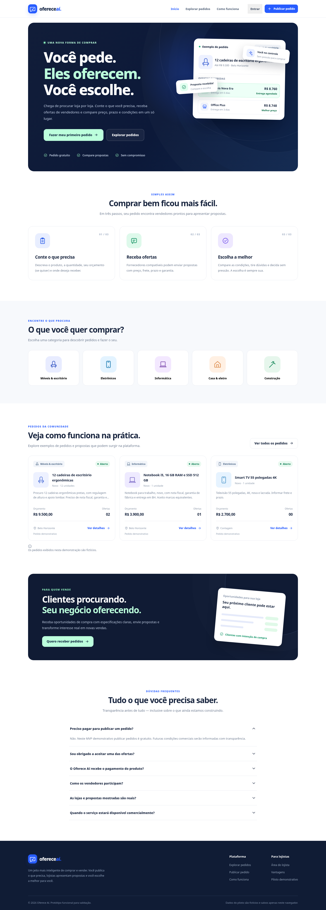
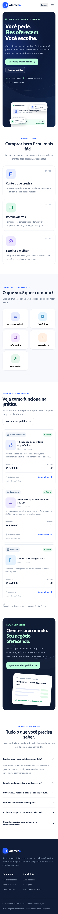
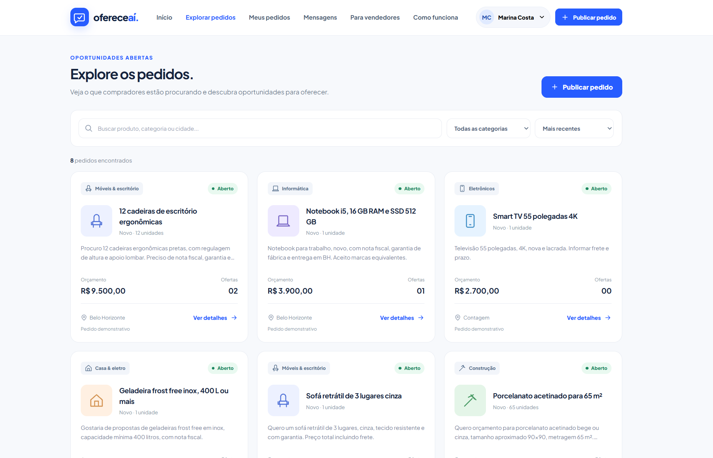
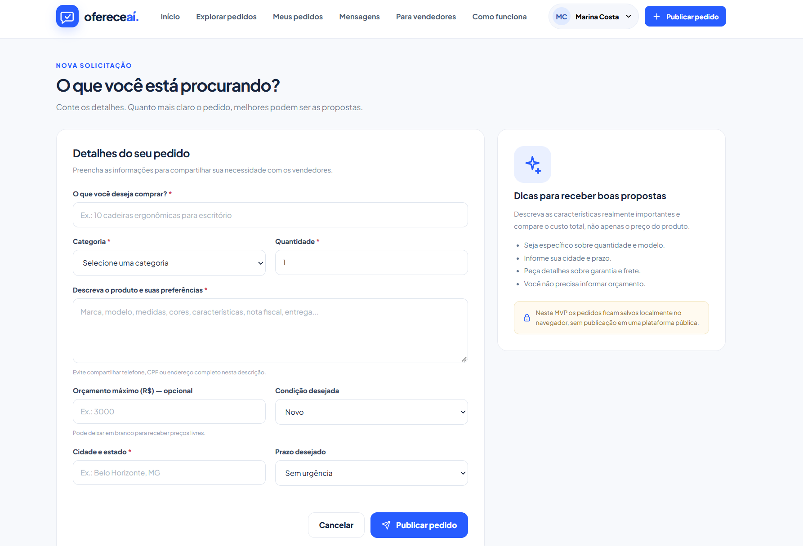
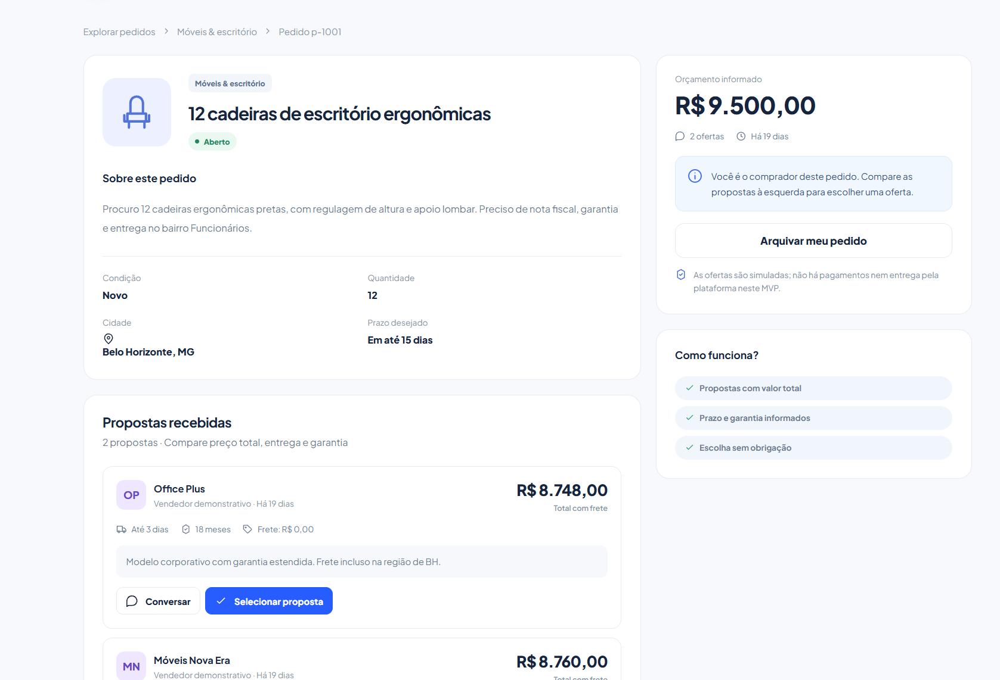
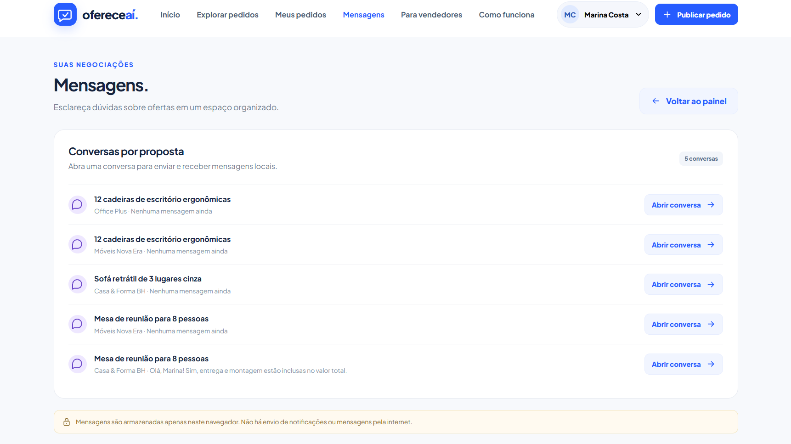
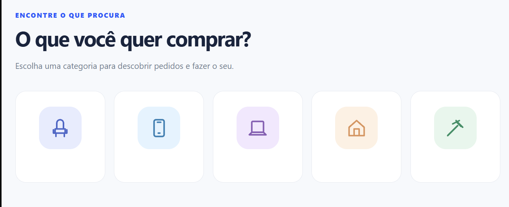
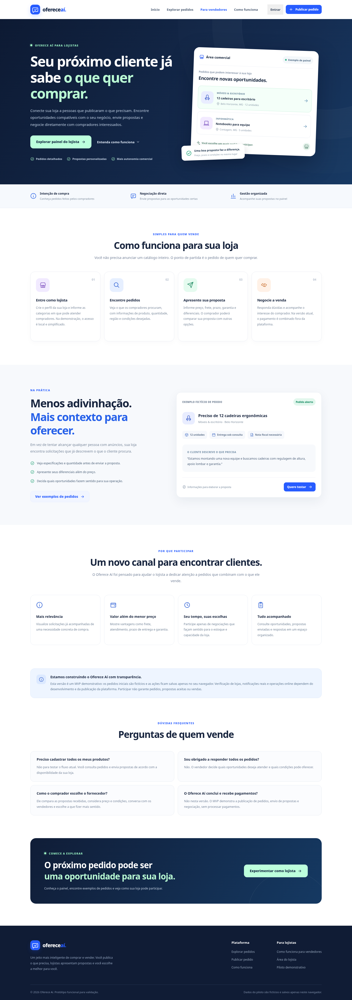

# DEVLOG — OfereceAí 3.0

**Da ideia ao MVP: como conduzi um projeto experimental de marketplace inverso com auxílio de IA**  
**Autor:** David Alexander · **Versão documentada:** 3.0

> Este é meu registro de desenvolvimento, não o anúncio de uma startup. Meu objetivo com o OfereceAí é demonstrar **como transformei uma ideia em um produto digital navegável usando IA**, incluindo os pedidos que fiz, as mudanças de direção e as limitações do resultado.

## 1. A ideia que coloquei na conversa

Comecei com uma pergunta: **e se, em vez de procurar anúncios, eu pudesse dizer o que quero comprar e receber propostas dos vendedores?**

Dei o nome **OfereceAí** ao experimento e trabalhei com a frase “Você pede. Eles oferecem.” No marketplace tradicional, o lojista publica e o consumidor pesquisa. No modelo que imaginei, a ordem muda:

```text
MODELO TRADICIONAL
Vendedor anuncia → Comprador procura → Comprador escolhe

MODELO INVERSO QUE EU QUIS EXPLORAR
Comprador pede → Vendedores oferecem → Comprador compara e escolhe
```

Usei o exemplo de um **iPhone 15 de 128 GB**, novo, com nota fiscal e orçamento de até R$ 3.000. Queria mostrar que um pedido pode carregar contexto: preço desejado, entrega, garantia e alternativas equivalentes. Depois, o MVP passou a usar também exemplos como a compra de **12 cadeiras ergonômicas**.

Eu não estava tentando provar, com esse protótipo, que já existia um mercado validado. Queria experimentar **como seria a experiência de ambos os lados de uma plataforma desse tipo**.

## 2. Antes das telas, organizei o raciocínio

Preparei um **prompt mestre dividido em 20 partes**, com questões sobre problema, concorrentes, públicos, jornadas, ofertas, monetização, riscos, UX, tecnologia, IA, legislação, métricas e validação.

Pedi que a análise fosse crítica. Eu queria conhecer os pontos fracos da ideia, e não apenas receber elogios sobre seu potencial. O exercício me ajudou a enxergar uma tensão básica: compradores precisam receber propostas; vendedores precisam encontrar pedidos interessantes.

Nessa etapa considerei nichos e regiões para uma hipótese de mercado — como móveis e equipamentos de escritório. Mas **não fiz uma operação comercial**. No MVP, mantive várias categorias para representar diferentes situações de uso.

O valor dessa primeira fase para meu portfólio está em ter **definido o problema, os fluxos e as restrições antes de pedir o código**.

## 3. Pedi à IA que construísse o site

Depois da exploração inicial, deixei de discutir apenas o conceito e pedi: **“Eu quero que você faça esse site que conversamos.”** Solicitei uma entrega caprichada e revisão do resultado.

Recebi uma versão de demonstração em HTML e um pacote com arquivos organizados. O projeto passou a ter homepage, navegação e fluxos demonstrativos de comprador, lojista e administrador.


*Primeira homepage em desktop. Foi a referência inicial do visual e da estrutura de apresentação da ideia.*


*Primeira versão mobile. A responsividade fez parte do MVP, não ficou como promessa futura.*

O que recebi não era um serviço online com usuários reais. Era um **MVP local**, no qual eu podia navegar e simular as decisões principais do produto.

## 4. O código que de fato ficou no projeto

A implementação disponibilizada usa **HTML, CSS e JavaScript nativo**, com navegação por hash e persistência no `localStorage`. Não preciso instalar dependências para abrir `site/index.html`.

```text
site/
├── index.html
├── styles.css
├── app.js
├── assets/favicon.svg
├── README.md
└── TESTES.md
```

Essa simplicidade combinou com o objetivo experimental: reduzir o atrito para abrir, inspecionar e demonstrar o produto.

Eu também conversei sobre Next.js, React, TypeScript, Tailwind, Supabase e PostgreSQL quando montei um contexto para outra IA. **Foram sugestões para uma eventual evolução**, não a stack implementada. Da mesma forma, não tenho backend, autenticação em servidor ou deploy público nesta versão.

## 5. Construí a experiência do comprador

Queria que o conceito pudesse ser visto em ação, então o fluxo precisou ir além de uma página bonita. O comprador demonstrativo pode navegar entre pedidos, preencher uma solicitação, informar quantidade, localização, prazo e um orçamento opcional, além de ver propostas recebidas.


*Listagem de pedidos fictícios, com busca, filtros e ordenação. Aqui representei o ponto de encontro entre a demanda publicada e os vendedores interessados.*


*Formulário de criação. Eu quis permitir que o comprador descrevesse as condições desejadas, e não somente o nome do produto.*


*Exemplo de 12 cadeiras ergonômicas, orçamento informado e propostas de demonstração. A comparação de condições torna visível a lógica do marketplace inverso.*

Essas telas contêm **dados simulados**. Não houve compra nem recebimento de propostas por lojas externas à demonstração.

## 6. Modelei também o lado do vendedor

Para a experiência fazer sentido, precisei pensar em quem responderia aos pedidos. No painel demonstrativo de lojista, a ideia é encontrar oportunidades e enviar uma proposta com preço, frete, prazo, garantia e observações — sem obrigar o lojista a construir um catálogo de anúncios.

Mantive a regra conceitual de **propostas privadas**: o comprador vê as ofertas para compará-las, enquanto cada vendedor não visualiza os preços enviados por concorrentes.

Também incluí mensagens associadas às propostas, para simular dúvidas e negociações.


*Central de mensagens por proposta. O próprio protótipo avisa que essas conversas ficam no navegador; não há envio de mensagens pela internet.*

O material entregue ainda descreve perfis demonstrativos de administração, acompanhamento e mudança de status. Não incluí imagens dessas telas porque optei por publicar apenas as capturas que já reuni.

## 7. O ajuste visual que mudou a forma como eu pedia alterações

Em um momento, reparei que a área de categorias mostrava **cinco ícones sem os respectivos nomes**. Enviei a captura e pedi que o nome aparecesse abaixo de cada um.


*O problema visual que apresentei à IA: os ícones eram reconhecíveis, mas faltavam os rótulos de Móveis, Celulares, Informática, Casa e Construção.*

A primeira resposta resolveu a **imagem**, não necessariamente o arquivo do site. A aparência era o que eu tinha pedido, mas percebi que precisava ser explícito sobre o artefato que deveria mudar.

Então escrevi: **“Exato, mas quero que você faça isso no MVP.”**

Recebi uma nova versão dos arquivos, com a alteração descrita e os rótulos incorporados ao código. A documentação indicou que os filtros internos foram preservados.

Foi a lição mais concreta da jornada: **uma referência visual é útil, mas um protótipo editado e um arquivo de imagem são entregas diferentes**. Se eu preciso mudar o produto, tenho que pedir mudança **no produto**.

## 8. Troquei o rumo da monetização — como decisão de design

Perguntei como o OfereceAí poderia ganhar dinheiro. Discutimos comissões, assinaturas, leads, recursos premium e créditos para enviar propostas.

Eu **não gostei da venda de créditos** e disse que não queria usar isso por enquanto. Preferi orientar o conceito pelo **Modelo B**, de oportunidades comerciais para vendedores. Era uma escolha de direção do produto experimental, não uma receita já implantada ou uma decisão de lançar a empresa.

A partir daí, pedi uma página **“Para vendedores”**, explicando como encontrar pedidos, enviar propostas e acompanhar oportunidades — **sem preços, assinaturas anunciadas ou créditos**.


*Página incluída após eu restringir o modelo conceitual. O objetivo da tela é explicar o funcionamento para lojistas, sem fingir que já existe uma operação comercial.*

A nova versão foi entregue com integração à navegação, à chamada para lojistas na homepage e ao rodapé. Isso tornou a proposta de valor mais compreensível também para quem simula o papel de vendedor.

## 9. Como conduzi a colaboração com IA

Não tratei o trabalho como um único prompt mágico. Fui alternando entre **visão ampla e instruções pontuais**:

| Situação | O que eu fiz | Aprendizado |
| --- | --- | --- |
| Começo da ideia | Escrevi um prompt mestre com 20 frentes e pedi crítica. | Definir o problema antes de escolher a interface. |
| Primeiro MVP | Pedi o site completo, com revisão do resultado. | Diferenciar uma demo funcional de um serviço real. |
| Falha de legibilidade | Enviei screenshot e pedi nomes sob os ícones. | Mostrar a tela torna a solicitação mais objetiva. |
| Resposta no formato errado | Esclareci: mudar **o MVP**, não gerar uma imagem. | Definir o artefato de saída evita retrabalho. |
| Modelo de negócios | Rejeitei créditos e escolhi o Modelo B como direção. | Uma restrição explícita evita recursos indesejados. |
| Página para lojistas | Pedi explicação sem valores. | Escopo claro importa tanto quanto funcionalidades. |
| Continuidade | Estruturei nome, objetivo e contexto para usar outra IA. | Transferir decisões reduz a necessidade de reexplicar tudo. |

Para mim, **desenvolvimento assistido por IA não é esconder a IA**. A IA ajudou a gerar e ajustar o material; eu estabeleci o conceito, avaliei propostas e indiquei o que deveria mudar.

### Economia de contexto e tokens: o que consigo afirmar

Eu **não tenho uma medição de tokens economizados**, e não houve no histórico uma refatoração técnica explicitamente documentada para reduzir tokens. Não vou inventar esses números.

O que fiz de verdade foi:

- Apontar uma mudança visual com **uma imagem e uma frase específica**, sem repetir o estudo de 20 partes.
- Solicitar atualização **sobre o MVP existente**, em vez de mandar recriar o site após cada ajuste.
- Reutilizar decisões já definidas — “Modelo B”, “sem créditos”, “sem preços” — na especificação da página para lojistas.
- Montar um texto estruturado de contexto para transferir o projeto a outra IA com menos ambiguidade.

São práticas de gestão de contexto e de redução de retrabalho, **não um benchmark de economia de tokens**.

## 10. Erros, testes e correções — sem inventar debugging

Nesta conversa não há um stack trace real seguido da sequência “colei o erro, testei a correção e confirmei o resultado”. Não seria correto fabricar essa história.

O ciclo de correção comprovado foi **de escopo e formato de entrega**:

```text
Vi um problema de UI
 → mostrei a captura de tela
 → recebi uma imagem corrigida
 → esclareci que precisava mudar o código do MVP
 → recebi os arquivos revisados
```

Outro ajuste real foi de **produto**: considerei modelos de monetização, descartei a venda de créditos e pedi uma página focada na experiência do vendedor.

O arquivo [`site/TESTES.md`](./site/TESTES.md) registra verificações relatadas durante a entrega da demonstração: navegação, formulários, propostas, mensagens e responsividade em diferentes larguras. **Esse relatório não substitui testes automatizados incluídos no repositório**, nem uma homologação independente que eu possa atribuir a mim sem evidências.

## 11. Segurança e dados no contexto de uma demonstração

Eu não precisava armazenar dados de clientes reais, então o MVP foi desenvolvido com **perfis e pedidos fictícios**. As informações de sessão e os pedidos ficam no `localStorage` do navegador.

Isso é suficiente para experimentar os fluxos no mesmo dispositivo, mas tem limites importantes:

- “Comprador demo”, “Lojista demo” e “Admin demo” **não são autenticação verdadeira**.
- A separação de ofertas é uma regra implementada na interface local, não uma garantia de autorização em servidor.
- Não existem variáveis de ambiente com credenciais necessárias para rodar o MVP.
- Não há banco remoto, notificações externas, pagamentos ou dados sincronizados entre usuários.
- O protótipo não deve receber senhas, documentos ou informações sensíveis.

Eu quis deixar esses limites claros no GitHub para não apresentar uma **simulação convincente** como uma **plataforma online segura**.

## 12. O que implementei e o que apenas discuti

| Tema | Estado da versão 3.0 |
| --- | --- |
| Conceito de marketplace inverso | Definido e representado em fluxos de demonstração. |
| Interface responsiva | Entregue no MVP. |
| Publicação de pedidos | Funcionamento local demonstrativo. |
| Envio, comparação e seleção de ofertas | Funcionamento local demonstrativo. |
| Mensagens e painel administrativo | Fluxos demonstrativos locais. |
| Página Para vendedores | Incluída, sem preços ou créditos. |
| Backend e banco compartilhado | Não implementados. |
| Autenticação em servidor | Não implementada. |
| Pagamentos | Não implementados. |
| Deploy público | Não realizado ou informado. |

**Meu objetivo atual não é comercializar o OfereceAí.** Por isso, as integrações de produção não são etapas atrasadas: simplesmente **estão fora do escopo deste experimento**.

## 13. Por que preparei o projeto para o GitHub

Depois de montar e ajustar o MVP, decidi transformar a própria jornada em portfólio. Pedi dois documentos com objetivos diferentes:

- **README:** apresentar o conceito, mostrar o que a demonstração faz e explicar como executar o código.
- **DEVLOG:** narrar, em primeira pessoa, como orientei a IA, mudei decisões e revisei o protótipo.

Para evitar screenshots inventados, reuni **oito imagens** que já estavam disponíveis, incluindo novas capturas de explorar pedidos, detalhar propostas, mensagens e publicar pedido. Retirei as marcações “colar print aqui” das telas que não pretendo documentar agora.

Também pedi uma revisão antes de publicar para procurar dados sensíveis, credenciais, imagens faltantes e links quebrados. A auditoria anterior não apontou segredos evidentes; ainda assim, isso não substitui uma análise exaustiva de segurança.

## 14. O que aprendi e posso aplicar a outros projetos

1. **Começar pelas regras:** uma interface bonita não substitui a clareza do problema e do fluxo.
2. **Mostrar o defeito:** um print pode comunicar um problema visual melhor que um parágrafo.
3. **Pedir o artefato certo:** um mockup editado não altera o código do site.
4. **Restringir explicitamente:** “sem créditos” e “sem valores” foram decisões úteis para manter o escopo.
5. **Continuar de onde parei:** pedir revisões sobre os arquivos existentes ajuda a comparar mudanças.
6. **Não atribuir a mim testes que não executei:** relatórios de entrega e validação independente são coisas distintas.
7. **Ser transparente sobre IA:** meu papel foi direcionar o projeto e avaliar escolhas; a IA participou da implementação.
8. **Registrar o que não existe:** não preciso inventar backend, deploy, métricas ou clientes para demonstrar aprendizado.

## 15. Imagens deste registro

Mantive somente as oito capturas disponíveis e com referências válidas no repositório:

| Arquivo | Registro |
| --- | --- |
| `home-desktop-primeiro-mvp.png` | Homepage desktop da primeira entrega. |
| `home-mobile-primeiro-mvp.png` | Versão mobile inicial. |
| `explorar-pedidos.png` | Listagem e filtros dos pedidos. |
| `publicar-pedido.png` | Formulário de solicitação. |
| `detalhe-pedido.png` | Detalhes e propostas simuladas. |
| `mensagens.png` | Central de conversas locais. |
| `categorias-antes.png` | Problema de UI que motivou a correção. |
| `pagina-para-vendedores.png` | Página criada após a decisão pelo Modelo B. |

Não há referências a prints pendentes nesta versão do DEVLOG.

## 16. Onde a jornada está agora

Cheguei à **versão 3.0 de um MVP local, navegável e documentado**. Não estou anunciando uma empresa, buscando clientes nem preparando um lançamento comercial. Quero compartilhar no GitHub **um experimento honesto de construção de produto com IA** — da ideia original às telas, das solicitações amplas às correções pontuais e das possibilidades discutidas ao código realmente entregue.

Se eu retomar o projeto no futuro, poderei registrar novas telas, revisões e decisões. Por enquanto, considero que a contribuição mais interessante deste repositório é o próprio processo: **como usei IA para transformar uma hipótese de produto em um artefato concreto, sem esconder o que foi assistido nem exagerar o que ficou pronto.**

---

[← Voltar ao README](./README.md)
