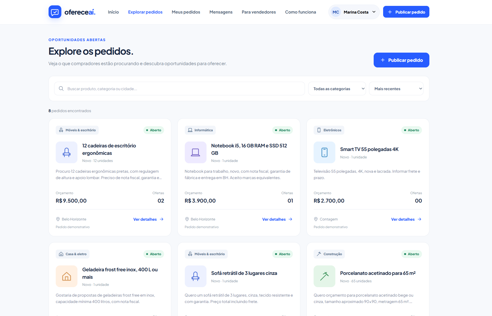
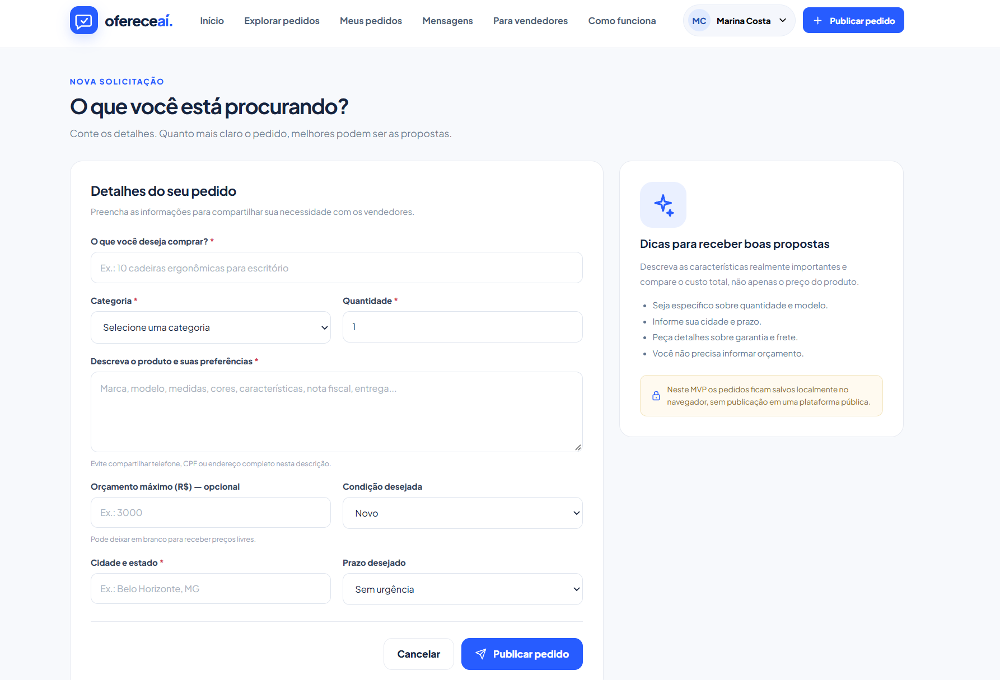
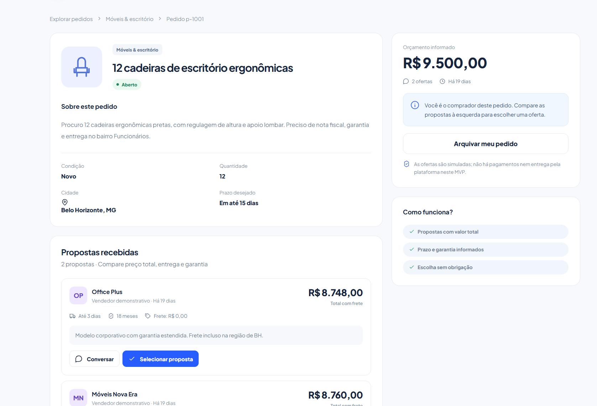
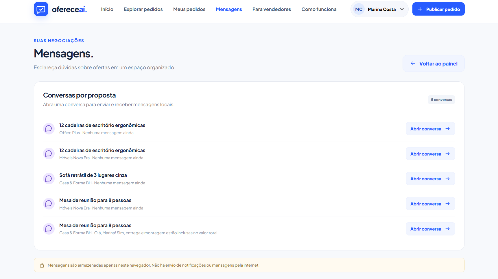

# OfereceAí — Marketplace Inverso

**Você pede. Eles oferecem. Você escolhe.**


> **Projeto experimental de marketplace inverso desenvolvido com auxílio de inteligência artificial. O objetivo é demonstrar o processo de criação de um produto digital, desde a concepção da ideia até a construção e evolução de um MVP funcional.**
>
> **Autor:** David Alexander · **Versão:** 3.0 · **Status:** demonstração local · **Site público:** não disponibilizado.

O OfereceAí é um **estudo prático de conceito, interface e fluxos de usuário**. Não é uma empresa em operação, não tem compradores ou lojistas reais cadastrados e não processa transações. O repositório documenta tanto a experiência navegável quanto as decisões tomadas ao longo do desenvolvimento assistido por IA.

**📖 [Leia o DEVLOG: a jornada de desenvolvimento, as decisões e as iterações com IA](./DEVLOG.md)**

## A ideia

Em um marketplace tradicional, o vendedor publica produtos e o comprador procura anúncios. No modelo inverso explorado pelo OfereceAí, **o comprador inicia com um pedido** e os vendedores podem apresentar propostas.

```text
MARKETPLACE TRADICIONAL
Vendedor anuncia produto → Comprador pesquisa → Comprador escolhe

OFERECEAÍ (CONCEITO EXPERIMENTAL)
Comprador publica pedido
         ↓
Plataforma apresenta o pedido aos lojistas compatíveis
         ↓
Lojistas enviam propostas individuais
         ↓
Comprador compara preço, prazo, frete e garantia
         ↓
Comprador conversa e seleciona uma proposta (simulação)
```

**Exemplo do MVP:** alguém procura 12 cadeiras ergonômicas para escritório. No ambiente demonstrativo, o pedido apresenta quantidade, local, prazo e orçamento opcional; propostas fictícias permitem experimentar a comparação entre condições comerciais.

## O que foi construído

A **versão 3.0** reúne uma aplicação web responsiva e navegável, com perfis simulados de comprador, lojista e administrador.

| Área | O que é possível experimentar |
| --- | --- |
| **Página pública** | Apresentação do conceito, categorias, pedidos de exemplo, busca e filtros. |
| **Comprador demo** | Criar pedidos locais, informar preferências e orçamento opcional, comparar propostas e trocar mensagens de demonstração. |
| **Lojista demo** | Explorar oportunidades, enviar/editar propostas com preço e prazo e visualizar conversas locais. |
| **Admin demo** | Explorar indicadores demonstrativos, moderação de pedidos, exportação CSV e redefinição dos dados de exemplo. |
| **Para vendedores** | Ler uma explicação pública do fluxo para lojas, sem preços nem venda de créditos. |

As cinco categorias exibidas na página inicial são **Móveis, Celulares, Informática, Casa e Construção**. A inclusão dos nomes abaixo dos ícones foi uma das mudanças de interface solicitadas durante o processo.

### Capturas do MVP

**Primeiras versões da página inicial**


*Primeira interface desktop documentada, anterior aos ajustes posteriores.*


*Adaptação mobile do protótipo.*

**Exploração e criação de pedidos**


*Busca, filtros e cartões de solicitações fictícias.*


*Formulário que estrutura a intenção de compra no navegador.*

**Propostas e conversas**


*Detalhe de solicitação e comparação entre propostas simuladas.*


*Mensagens vinculadas às ofertas, armazenadas apenas localmente.*

**Página dedicada aos lojistas**


*Explicação do conceito para lojistas; não apresenta planos, valores ou créditos.*

A oitava imagem, `imagens/categorias-antes.png`, aparece no **[DEVLOG](./DEVLOG.md)** para ilustrar uma correção de interface feita durante o desenvolvimento.

## Como executar localmente

A versão atual usa **HTML, CSS e JavaScript nativos**. Não exige instalação de dependências, contas em serviços externos, variáveis de ambiente ou banco de dados.

1. Baixe o repositório em **Code → Download ZIP** (ou clone usando Git).
2. Extraia o conteúdo e abra `site/index.html` no navegador.
3. Use **Entrar** para alternar entre os perfis de demonstração.

Se preferir executar por um servidor HTTP estático:

```bash
cd site
python -m http.server 8000
```

Abra `http://localhost:8000`. Em alguns sistemas, use `python3` em vez de `python`. Esse servidor serve arquivos estáticos; **não é um backend**.

### Experimento guiado

1. Entre como **Comprador demo** e publique um pedido fictício.
2. Troque para **Lojista demo** e localize esse pedido.
3. Envie uma proposta com preço, frete e prazo.
4. Volte ao comprador, compare a oferta e abra a conversa.
5. Selecione a proposta para observar a mudança de estado local.
6. Explore o **Admin demo** e a página **Para vendedores**.

**Use somente dados fictícios.** Não inclua senhas, CPF, documentos ou informações financeiras reais. Não existe comunicação entre navegadores, compras, transferências ou mensagens enviadas pela internet.

## Tecnologias e estrutura

**Implementado:** HTML5, CSS3, JavaScript nativo, navegação por hash (`#/...`) e armazenamento no `localStorage` do navegador (`ofereceai_mvp_v1` e `ofereceai_session_v1`).

**Discutido, mas não implementado:** Next.js, React, TypeScript, Supabase/PostgreSQL, autenticação em servidor, pagamentos e hospedagem pública. Essas tecnologias apareceram na exploração de possibilidades, não no código da versão 3.0.

```text
.
├── README.md              # Apresentação do projeto experimental
├── DEVLOG.md              # Jornada narrada em primeira pessoa
├── CONTRIBUTING.md        # Como sugerir melhorias e colaborar
├── .gitignore
├── imagens/               # Oito capturas usadas na documentação
└── site/
    ├── index.html         # Página de entrada
    ├── styles.css         # Estilos e responsividade
    ├── app.js             # Interface, fluxos e estado local
    ├── assets/favicon.svg
    ├── README.md          # Guia técnico do protótipo
    └── TESTES.md          # Registro histórico das verificações relatadas
```

## Limites do experimento

- Os perfis de acesso são **simulações**, não autenticação segura.
- Os dados de demonstração ficam em `localStorage`: não há banco compartilhado nem sincronização entre pessoas ou dispositivos.
- Os pedidos, vendedores e propostas iniciais são fictícios.
- Não há cadastro/verificação real de lojistas, notificações externas ou processamento de pagamentos.
- Não há site público informado; o projeto foi preparado para execução local e apresentação do código no GitHub.
- `site/TESTES.md` registra verificações realizadas e relatadas na construção; **não é uma suíte automatizada versionada**.

Nenhuma dessas limitações impede o objetivo deste repositório: **mostrar a evolução de um MVP experimental e o processo de desenvolvimento assistido por IA**.

## Sobre o desenvolvimento

- **IA como ferramenta de colaboração:** requisitos, solicitações de alteração e critérios de aceitação foram dirigidos pelo autor; a IA participou da análise, geração e revisão do material.
- **Iteração a partir de evidências visuais:** uma captura revelou que faltavam nomes abaixo dos ícones; após uma primeira resposta em imagem, o pedido foi refinado para modificar o código do MVP.
- **Decisões de produto documentadas:** a hipótese de venda de créditos foi descartada por enquanto e a página para lojistas foi criada sem tabela de valores.
- **Contexto reaproveitável:** prompts e decisões anteriores foram organizados para orientar novas etapas sem recomeçar a definição da ideia.

Esses exemplos são detalhados, com imagens, no **[DEVLOG.md](./DEVLOG.md)**. Não há métricas verificadas de economia de tokens nem uma alegação de que o autor escreveu manualmente todo o código.

## Contribuições

**Sugestões, issues e propostas de melhoria são bem-vindas**, especialmente sobre UX, acessibilidade, qualidade do código e documentação. Veja [CONTRIBUTING.md](./CONTRIBUTING.md).

**Licença:** ainda não definida. A publicação do código no GitHub não o torna automaticamente de domínio público nem autoriza uso ou redistribuição irrestritos. Antes de reutilizar trechos ou submeter contribuições de código, observe essa condição.

## Créditos

**Ideia, decisões de produto, orientação e documentação da jornada:** David Alexander.  
**Desenvolvimento do MVP:** processo colaborativo com auxílio de inteligência artificial.  
**Versão documentada:** 3.0.

*O OfereceAí é um exercício de construção de produto digital e documentação do processo. Não representa oferta de serviço comercial nem anúncio de uma empresa em funcionamento.*
